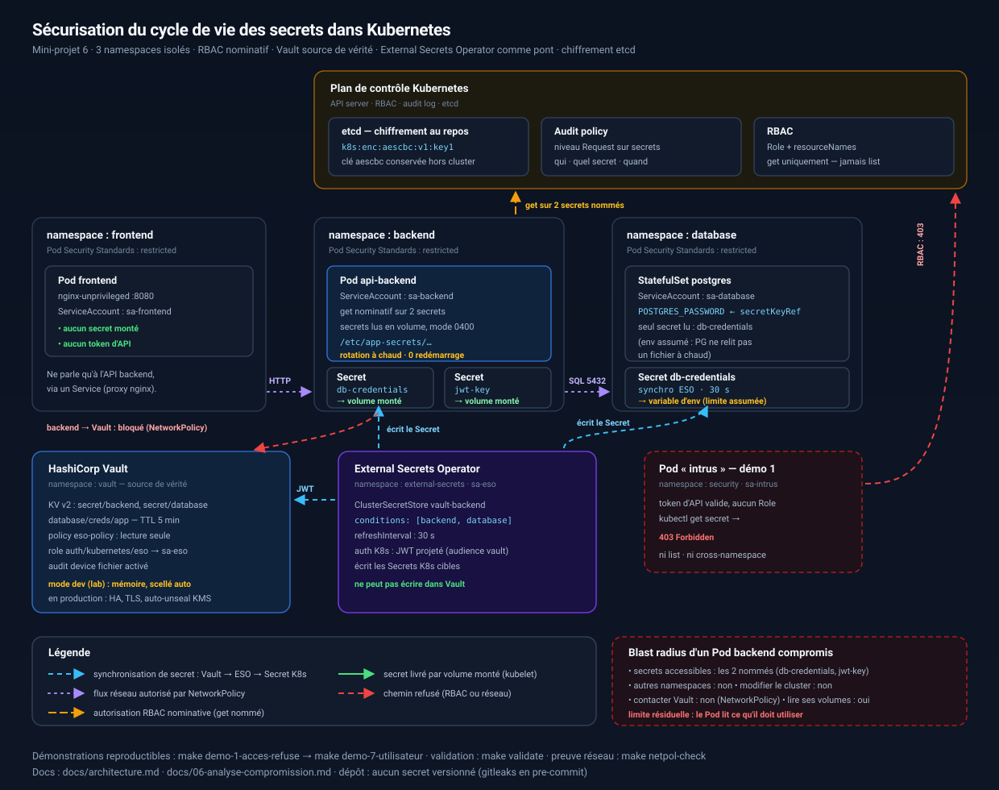

# Sécurisation du cycle de vie des secrets dans Kubernetes

**Mini-projet 6 — dossier de rendu**

Application de démonstration : frontend / API backend / PostgreSQL, déployés
dans trois namespaces isolés, avec Vault comme source de vérité des secrets et
External Secrets Operator comme pont de synchronisation.

> Ce document est **généré** à partir des fichiers de `docs/` par
> `make rapport`. Chaque partie est également disponible séparément, avec ses
> liens croisés vers le code.

---

## Sommaire

1. [Partie 1 — Matrice des secrets](#partie-1--matrice-des-secrets)
2. [Partie 2 — Sécurité des Secrets Kubernetes natifs](#partie-2--sécurité-des-secrets-kubernetes-natifs)
3. [Partie 3 — Gestion des accès et RBAC](#partie-3--gestion-des-accès-et-rbac)
4. [Partie 4 — Cycle de vie des secrets](#partie-4--cycle-de-vie-des-secrets)
5. [Partie 5 — HashiCorp Vault et External Secrets Operator](#partie-5--hashicorp-vault-et-external-secrets-operator)
6. [Partie 6 — Analyse de sécurité et scénarios de compromission](#partie-6--analyse-de-sécurité-et-scénarios-de-compromission)
7. [Démonstrations et livrables](#démonstrations-et-livrables)
8. [Partie 7 — Comparaison des approches et réponse argumentée](#partie-7--comparaison-des-approches-et-réponse-argumentée)
9. [Réponse à la question centrale](#réponse-à-la-question-centrale)
10. [Architecture cible](#architecture-cible)

---

## Résumé exécutif

| Question | Réponse courte | Preuve |
|----------|----------------|--------|
| Un Pod non autorisé peut-il lire un secret ? | Non — 403 Forbidden, token valide mais aucun droit | démo 1 |
| Un workload reçoit-il plus que nécessaire ? | Non — `get` sur des noms précis, jamais `list` | démo 2 |
| etcd protège-t-il les secrets ? | Oui — `aescbc`, préfixe `k8s:enc:aescbc:v1:key1` | démo 3 |
| Une rotation exige-t-elle un redémarrage ? | Non — Vault → ESO → volume, en moins de 90 s | démo 4 |
| Le backend peut-il joindre Vault directement ? | Non — NetworkPolicy | démo 5 |
| Un secret peut-il fuiter via Git ? | Détecté par gitleaks en pre-commit | démo 6 |
| Et un humain non autorisé ? | Refusé : le RBAC cible un groupe, pas un compte | démo 7 |

**Ce que le projet ne prétend pas faire** : protéger contre un administrateur
du cluster malveillant, ni contre un workload légitime compromis qui utilise
ses propres permissions. Voir la partie 6.

---


<div style="page-break-after: always"></div>

# Partie 1 — Matrice des secrets


> « Un secret qu'on n'a pas identifié ne sera pas protégé. »
> Cette matrice est le point de départ de tout le reste : chaque ligne justifie
> une décision de RBAC, de chiffrement ou de rotation dans les parties suivantes.

## 1.1 Inventaire exhaustif

| # | Secret | Composant consommateur | Type | Sensibilité | Créé par | Durée de vie attendue |
|---|--------|------------------------|------|-------------|----------|-----------------------|
| S1 | Mot de passe PostgreSQL | `api-backend` | Identifiant DB | **Critique** | Vault (seed initial aléatoire), distribué par ESO | 30 jours (cible) / rotation à la demande |
| S2 | URL de connexion DB | `api-backend` | Identifiant DB | **Critique** | Composée à partir de S1 (host/port/db non secrets) | Identique à S1 |
| S3 | Clé JWT de signature | `api-backend` | Clé cryptographique | **Critique** | Vault KV (`secret/backend/jwt-key`) | 90 jours, avec chevauchement de 24 h pour ne pas invalider les tokens en vol |
| S4 | Clé API service externe | `api-backend` | Token API | Haute | Fournisseur partenaire → Vault | 180 jours, imposée par le fournisseur |
| S5 | Certificat TLS | Ingress / frontend | Certificat x509 | Haute | ACME / cert-manager → Secret TLS | 90 jours (Let's Encrypt) |
| S6 | Token d'authentification CI/CD | Pipeline GitLab/GitHub | Token de service | Haute | Plateforme CI → OIDC éphémère | Une exécution de pipeline (< 1 h) |
| S7 | Mot de passe PostgreSQL vu par la base | `postgres` | Identifiant DB | **Critique** | Vault, synchronisé par ESO | Identique à S1 |
| S8 | Jeton de ServiceAccount ESO | `external-secrets` | Token de service | Haute | Kubernetes (projeté) | 20 min (TTL du token Vault) |
| S9 | Clé de scellement Vault (unseal) | Opérateur humain | Clé cryptographique | **Critique** | Shamir 3/5, hors cluster | Permanente (rotation annuelle) |
| S10 | Token root Vault | Opérateur | Token privilégié | **Critique** | Initialisation Vault | Usage unique, révoqué immédiatement après le bootstrap |
| S11 | Clé de chiffrement etcd (aescbc) | kube-apiserver | Clé cryptographique | **Critique** | Générée par l'opérateur, hors cluster | Rotation semestrielle |

> Dans ce lab, S9 et S10 sont simplifiés (Vault en mode dev, token `root`
> trivial). C'est assumé et documenté comme limite : voir
> [06-analyse-compromission.md](06-analyse-compromission.md).

## 1.2 Qui crée, qui consomme, qui peut lire

| Secret | Namespace | Créé par | Consommé par | Lisible par (RBAC) | Stocké dans etcd ? |
|--------|-----------|----------|--------------|--------------------|--------------------|
| S1/S2 | `backend` | ESO | `api-backend` (volume) | `sa-backend` uniquement, `get` seulement | Oui, **chiffré** |
| S3 | `backend` | ESO | `api-backend` (volume) | `sa-backend` (get) + groupe `developers` (get) | Oui, **chiffré** |
| S4 | `backend` | ESO | `api-backend` (volume) | **Personne** côté workload : ESO écrit, le Pod le monte | Oui, **chiffré** |
| S5 | `frontend` | cert-manager | Ingress | Contrôleur d'Ingress | Oui, chiffré |
| S6 | — | OIDC du runner CI | Pipeline (durée du job) | Aucun stockage permanent | **Non** (jeton éphémère) |
| S7 | `database` | ESO | `postgres` (env) | `sa-database` (get) | Oui, **chiffré** |
| S8 | `external-secrets` | Kubernetes | ESO (vers Vault) | Vault via TokenReview | Non (token projeté, en mémoire) |
| S9/S10 | hors cluster | Opérateur | Opérateur | — | Non |
| S11 | hors cluster | Opérateur | kube-apiserver | — | Non (fichier dans le nœud) |

**Le cas S4 est volontairement paradoxal** et c'est le point le plus intéressant
de la matrice : la clé API du partenaire est présente dans le namespace
`backend`, mais `sa-backend` ne peut pas la lire via l'API (elle n'est pas dans
`resourceNames`). Le Pod la consomme pourtant… parce qu'il l'a montée en
volume. Autrement dit : *lire un secret et le consommer sont deux permissions
distinctes*, et le RBAC ne contrôle que la première. Ce point est démontré en
[démo 2](07-demonstrations.md#démo-2).

## 1.3 Analyse d'impact en cas de fuite

| Secret | Vecteur de fuite réaliste | Impact immédiat | Impact différé | Détection | Réduction du dommage |
|--------|---------------------------|-----------------|----------------|-----------|----------------------|
| S1 (mdp DB) | Log applicatif, dump etcd, `kubectl describe` | Lecture/écriture de toute la base applicative | Exfiltration de données personnelles, RGPD | Audit log API, logs PostgreSQL (`log_connections`) | Rotation + `ALTER USER` ; TTL DB court |
| S2 (URL DB) | ConfigMap commitée, message d'erreur | Idem S1 si le mot de passe y figure | Idem | gitleaks pre-commit | Ne jamais mettre l'URL complète ; seulement les composants |
| S3 (JWT) | Volume monté exfiltré, image compromise | **Forge de tokens valides pour n'importe quel utilisateur** | Prise de contrôle de comptes, contournement total de l'authentification | Anomalies de `kid`/`iat` | Rotation avec chevauchement, `kid` en en-tête |
| S4 (clé API) | Log d'appel sortant, dépôt public | Consommation du quota du partenaire | Facturation, blocage du compte partenaire | Alertes de débit côté fournisseur | Révocation côté fournisseur (seule action efficace) |
| S5 (TLS) | Partage du fichier `.pem` | Usurpation du domaine, MITM | Perte de confiance, vols de session | Certificate Transparency | Réémission + révocation OCSP |
| S6 (CI/CD) | Log de pipeline, `.gitlab-ci.yml` | Déploiement d'une image malveillante | Persistance dans le cluster | Audit des `deployments` | OIDC à durée de vie = durée du job, scopes minimaux |
| S9/S10 (Vault) | Post-it, partage de mot de passe, dump mémoire | **Tous les secrets, d'un coup** | Compromission totale et durable | Audit device Vault, alerte sur `sys/*` | Scellement Shamir 3/5, auto-unseal KMS, tokens à TTL court |

## 1.4 Règles dérivées de la matrice

Ces règles sont appliquées mécaniquement dans le code du dépôt :

1. **Aucun secret dans Git** — la matrice ne contient aucun *nom de variable*
   secret, seulement des identifiants (S1…S11). Voir `.gitleaks.toml`.
2. **Un consommateur = un ServiceAccount** — ni `default`, ni partage entre
   composants (`infrastructure/rbac/serviceaccounts.yaml`).
3. **`resourceNames` obligatoire** pour tout accès aux Secrets
   (`infrastructure/rbac/backend-rbac.yaml`).
4. **Le secret le plus sensible commande le contrôle le plus fort** :
   S1/S3 → volume monté + rotation automatique ; S5 → géré par cert-manager ;
   S9/S10 → jamais dans le cluster.
5. **Tout secret a une date de mort** : un secret sans TTL est un secret
   compromis en attente (partie 4).

---

<div style="page-break-after: always"></div>

# Partie 2 — Sécurité des Secrets Kubernetes natifs


> Un Secret Kubernetes n'est pas un coffre-fort : c'est un objet de l'API,
> stocké dans etcd, dont la valeur est encodée en **Base64**. Base64 n'est pas
> du chiffrement. Sans `EncryptionConfiguration`, quiconque lit l'objet — ou
> accède à etcd — voit la valeur en clair.

## 2.1 Ce qui est appliqué dans ce dépôt

| Contrôle | Implémentation | Fichier |
|----------|----------------|---------|
| Secrets créés dans le bon namespace, hors Git | Créés par ESO depuis Vault, jamais commités | `infrastructure/eso/externalsecrets.yaml` |
| Chiffrement au repos dans etcd | `aescbc` (AES-256-CBC + HMAC), clé aléatoire 32 octets | `infrastructure/encryption/encryption-config.yaml.tpl` |
| Rechargement à chaud de la clé | `--encryption-provider-config-automatic-reload=true` | `clusters/kind-config.yaml.tpl` |
| Détection de fuite dans Git | gitleaks en pre-commit + scan d'historique | `.pre-commit-config.yaml`, `.gitleaks.toml` |
| Injection par volume, pas par `envFrom` | `volumes[].secret` + `volumeMounts` | `apps/backend/deployment.yaml` |
| Fichiers de secret en `0400` | `defaultMode: 0400` + `items` restrictifs | `apps/backend/deployment.yaml` |
| Audit des accès | politique d'audit niveau `Request` sur `secrets` | `infrastructure/encryption/audit-policy.yaml` |

## 2.2 Pourquoi `aescbc` et pas `secretbox` ?

| Provider | Chiffrement | Statut Kubernetes | Choix ici |
|----------|-------------|-------------------|-----------|
| `identity` | aucun | déconseillé (laisse tout en clair) | utilisé en **dernière** position uniquement pour migrer |
| `aescbc` | AES-256-CBC + HMAC-SHA256 | recommandé, disponible partout | **retenu** |
| `secretbox` | XSalsa20 + Poly1305 | plus rapide, plus récent | alternative valable |
| provider KMS (plugin) | clé dans un HSM/KMS | recommandé en production | hors périmètre du lab |

`aescbc` a été retenu parce qu'il est **explicable en une phrase** et que sa
clé est un simple bloc base64 de 32 octets — donc facile à gérer, à faire
tourner et à auditer. En production sur un cloud, on préfère un provider KMS :
la clé ne vit alors jamais dans un fichier.

## 2.3 Le piège du `identity: {}` en dernière position

```yaml
providers:
  - aescbc: { keys: [ { name: key1, secret: <32 octets base64> } ] }
  - identity: {}          # ⚠️ dernier provider = lecture seule, mais…
```

- **Écriture** : le premier provider chiffre → `aescbc`. Correct.
- **Lecture** : Kubernetes essaie les providers dans l'ordre ; `identity`
  permet de lire les objets **encore non chiffrés** (migration).
- **Le piège** : tant que `identity` est présent, *tous* les objets écrits
  avant l'activation du chiffrement restent lisibles en clair dans etcd.
  Il faut donc **réécrire** tous les secrets après activation :

```bash
kubectl get secrets -A -o json | kubectl replace -f -
```

C'est cette étape qui est oubliée dans la majorité des clusters « chiffrés ».
Le script `scripts/00-create-cluster.sh` crée le cluster *avec* le chiffrement
actif dès le départ : aucun objet en clair n'existe jamais, donc pas de
migration à faire — la posture la plus sûre.

## 2.4 Variable d'environnement vs volume monté

| Critère | `env` / `envFrom` | Volume monté |
|---------|-------------------|--------------|
| Visible dans `kubectl describe pod` | **Oui** (nom, parfois valeur selon l'outil) | Non |
| Visible dans `/proc/<pid>/environ` | **Oui** | Non |
| Hérité par les processus enfants | **Oui** | Non (il faut ouvrir le fichier) |
| Fuite dans un crash dump / log d'env | **Oui** | Non |
| Mis à jour après rotation | **Non** — figé au démarrage → redémarrage obligatoire | **Oui** — le kubelet réécrit le fichier (~60 s) |
| Contrôle de permission (mode UNIX) | Non | Oui (`0400`) |
| Choix de la clé exposée (`items`) | Non (tout ou rien) | Oui |
| Cas où il reste nécessaire | mot de passe d'une base qui ne sait pas lire un fichier (ex. `POSTGRES_PASSWORD`) | — |

**Décision du projet** :

- `api-backend` : **volume monté uniquement**, aucun `envFrom`. Le fichier est
  relu à chaque requête (aucun cache) → rotation transparente (démo 4).
- `postgres` : `secretKeyRef` sur `POSTGRES_PASSWORD`, avec une justification
  explicite dans le manifest — PostgreSQL ne peut pas relire un fichier pour
  son authentification. C'est une **limite assumée** : la rotation du mot de
  passe superutilisateur exige `ALTER USER`, donc une action explicite. Les
  *dynamic secrets* de Vault suppriment ce problème pour les rôles applicatifs
  (voir [05-vault-eso.md](05-vault-eso.md)).

## 2.5 Les manifests ne doivent jamais contenir de secret

Anti-pattern à ne jamais reproduire :

```yaml
apiVersion: v1
kind: Secret
metadata: { name: db-credentials, namespace: backend }
data:
  password: U3VwZXJTZWNyZXRQYXNzd29yZDEyMyE=   # ❌ base64, pas chiffré
```

Trois raisons, dans l'ordre de gravité :

1. **L'historique Git est éternel.** Supprimer le fichier ne supprime pas la
   valeur : `git log -p` la retrouve. Démonstration : démo 6.
2. **Le base64 est réversible par n'importe qui** (`base64 -d`). Ce n'est pas
   une protection, c'est un encodage.
3. **Un dépôt se clone.** Une seule copie suffit, et les forks survivent aux
   suppressions.

Conséquence appliquée : ce dépôt ne contient **aucun** `kind: Secret` avec des
données. Tous les `kind: Secret` produits le sont par ESO, à l'exécution.
Le validateur `make validate` vérifie cette propriété à chaque exécution.

## 2.6 Vérifier soi-même

```bash
# Ce que voit l'API (base64 — lisible par tous)
kubectl get secret db-credentials -n backend -o jsonpath='{.data.password}' | base64 -d

# Ce que contient réellement etcd (doit être illisible)
docker exec kind-control-plane etcdctl \
  --cacert /etc/kubernetes/pki/etcd/ca.crt \
  --cert   /etc/kubernetes/pki/etcd/server.crt \
  --key    /etc/kubernetes/pki/etcd/server.key \
  get /registry/secrets/backend/db-credentials
```

La sortie attendue commence par `k8s:enc:aescbc:v1:key1:`. Si elle contient du
JSON lisible, le chiffrement n'est pas actif — et tous les secrets du cluster
sont à considérer comme exposés.

Démonstration complète : [démo 3](07-demonstrations.md#démo-3).

---

<div style="page-break-after: always"></div>

# Partie 3 — Gestion des accès et RBAC


> Le RBAC est la première ligne de défense des secrets. Objectif : chaque
> ServiceAccount ne peut lire que les secrets dont il a besoin, **et rien de plus**.

## 3.1 Architecture des identités

| ServiceAccount | Namespace | Droits sur les Secrets | Justification |
|----------------|-----------|------------------------|---------------|
| `sa-backend` | `backend` | `get` sur `db-credentials`, `jwt-key` — **nominatif** | Consomme S1, S3 |
| `sa-frontend` | `frontend` | **aucun** | Ne doit jamais connaître un credential |
| `sa-database` | `database` | `get` sur `db-credentials` | A besoin de S7 uniquement |
| `sa-eso` | `external-secrets` | écriture des Secrets cibles via le ClusterRole d'ESO ; lecture Vault via `eso-policy` | Pont Vault → K8s |
| `sa-intrus` | `security` | **aucun** (aucun Role, aucun RoleBinding) | Pod de démonstration |
| `vault-auth` | `vault` | aucun secret K8s ; `system:auth-delegator` pour TokenReview | Vérifier les JWT |

`automountServiceAccountToken` est passé à `false` partout où c'est possible
(frontend, database, outils). Conséquence importante : un Pod compromis **ne
peut même pas parler à l'API Kubernetes**. Pour `api-backend`, il reste à
`true` uniquement parce que la démo 2 interroge l'API ; la configuration
« production » est indiquée en commentaire dans le manifest.

## 3.2 Le Role du backend, ligne par ligne

```yaml
apiVersion: rbac.authorization.k8s.io/v1
kind: Role
metadata:
  name: secret-reader-backend
  namespace: backend
rules:
  - apiGroups: [""]
    resources: ["secrets"]
    resourceNames: ["db-credentials", "jwt-key"]   # ← le cœur du sujet
    verbs: ["get"]                                  # ← ni list, ni watch
```

Trois décisions, chacune corrigeant une erreur fréquente :

| Élément | Ce qui arrive si on l'oublie |
|---------|------------------------------|
| `resourceNames` | `get` s'applique à **tous** les secrets du namespace |
| absence de `list` | `list` **ignore `resourceNames`** : `kubectl get secrets` listerait tous les noms → énumération gratuite |
| absence de `watch` | un attaquant observerait les rotations en temps réel (et les valeurs, sur les Secrets qu'il peut lire) |
| `namespace` explicite dans le `subjects` | un `RoleBinding` sans namespace prend celui du binding, mais un `ServiceAccount` mal nommé ailleurs échoue silencieusement |

### Le piège `list` + `resourceNames`

C'est la subtilité RBAC la plus importante du projet :

```yaml
# ❌ FAUX SENS DE SÉCURITÉ : resourceNames est ignoré pour list
rules:
  - apiGroups: [""]
    resources: ["secrets"]
    resourceNames: ["db-credentials"]
    verbs: ["list"]
```

Avec cette règle, `kubectl get secrets -n backend` renvoie **tous** les secrets
du namespace (les noms ; les valeurs restent protégées par `get`). Mais
l'énumération donne la carte du trésor : noms, tailles, dates de rotation,
annotations `owner`. Pire : `list` + `get` sur les noms découverts ne
fonctionne pas, mais `list` seul suffit à cibler une attaque.

**Règle du projet : aucun `list`, aucun `watch`, aucun `*` sur `secrets`.**
Vérifié mécaniquement par `make validate`.

## 3.3 Permissions dangereuses — inventaire et interdiction

| Permission | Risque | Statut dans le projet |
|------------|--------|----------------------|
| `verbs: ["list"]` sur `secrets` | Expose tous les noms de secrets, facilite l'énumération | **Interdit** (vérifié par `make validate`) |
| `verbs: ["watch"]` sur `secrets` | Interception des changements en temps réel | **Interdit** |
| `resourceNames` absent | Accès à TOUS les secrets du namespace | **Interdit** par convention + revue |
| `ClusterRole` sur `secrets` | Accès cross-namespace, blast radius maximal | **Aucun ClusterRole** applicatif ne porte sur les secrets |
| `create`/`update` sur `secrets` | Injection d'un secret forgé (ex. empoisonner `jwt-key`) | Aucun workload ne l'a ; seul ESO écrit |
| `escalate` / `bind` sur `roles`/`clusterroles` | Contournement total du RBAC | Non accordé |
| `impersonate` | Usurpation d'identité (dont les contrôleurs) | Non accordé |
| `pods/exec` | Rebond vers le SA d'un autre Pod | Non accordé aux workloads |
| `serviceaccounts/token` | Fabrication de jetons pour un autre SA | Non accordé |
| accès à `nodes/proxy` | Contournement de l'API et de l'audit | Non accordé |

Le ClusterRole existant dans le dépôt (`vault-auth-delegator`) est volontairement
limité à `system:auth-delegator` : il permet uniquement de créer des
`TokenReview` et `SubjectAccessReview`, pas de lire un secret.

## 3.4 Pourquoi pas de `ClusterRole` pour les secrets ?

Un `ClusterRole` lié via `ClusterRoleBinding` donne le même droit **dans tous
les namespaces, y compris ceux créés plus tard**. C'est le « blast radius
maximal » : une compromission dans `frontend` donne les secrets de `backend`,
`database`, et de tout namespace futur. Le projet n'utilise que des `Role`
(namespacés) + un `ClusterSecretStore` **restreint par `conditions`** pour ESO
(cf. `infrastructure/eso/cluster-secret-store.yaml`).

## 3.5 Le RBAC ne contrôle pas tout (à dire à l'oral)

Trois limites structurelles, qui justifient les autres couches :

1. **Le kubelet n'utilise pas le RBAC** pour fournir un secret monté. Un Pod
   dont le SA n'a *aucun* droit peut quand même consommer un secret monté →
   c'est pour cela que le contrôle réel est *ce qu'on monte dans le Pod*.
2. **Un administrateur du cluster lit tout.** `cluster-admin` peut lire les
   secrets (chiffrés dans etcd mais déchiffrés par l'API). Aucun RBAC ne
   protège contre l'admin malveillant.
3. **Le RBAC ne contrôle pas le réseau.** Un Pod peut appeler Vault
   directement si NetworkPolicy ne l'en empêche pas → démo 5.

## 3.6 Vérifier soi-même

```bash
# Le backend peut-il lire ce qu'il doit lire ?
kubectl auth can-i get secret/db-credentials -n backend \
  --as=system:serviceaccount:backend:sa-backend        # yes

# Peut-il énumérer ? (doit être non)
kubectl auth can-i list secrets -n backend \
  --as=system:serviceaccount:backend:sa-backend        # no

# Le frontend a-t-il un accès ? (doit être non)
kubectl auth can-i get secrets -n frontend \
  --as=system:serviceaccount:frontend:sa-frontend      # no

# Le SA intrus a-t-il un accès ? (doit être non)
kubectl auth can-i --list -n security \
  --as=system:serviceaccount:security:sa-intrus
```

Démonstrations : [démo 1](07-demonstrations.md#démo-1) (refus),
[démo 2](07-demonstrations.md#démo-2) (accès nominatif),
[démo 7](07-demonstrations.md#démo-7) (utilisateur humain).

---

<div style="page-break-after: always"></div>

# Partie 4 — Cycle de vie des secrets


> Un secret non géré finit par fuiter. Ce document couvre les six étapes, avec
> pour chacune : la pratique recommandée, le risque si elle est absente, et
> **ce qui est réellement implémenté dans ce dépôt** (pas seulement recommandé).

## 4.1 Vue d'ensemble

| Étape | Pratique recommandée | Risque si absent | Implémenté ici ? |
|-------|----------------------|------------------|------------------|
| **Création** | Généré automatiquement, jamais tapé à la main, stocké immédiatement dans le gestionnaire | Secret faible ou réutilisé | Oui — `openssl rand` dans `01-deploy-vault-eso.sh`, seed direct dans Vault |
| **Stockage** | Vault **ou** Secret K8s chiffré au repos dans etcd | Exposition si accès à etcd | Oui — Vault (source de vérité) **et** `aescbc` dans etcd (double couche) |
| **Distribution** | Injection par sidecar ou volume monté, jamais en variable d'env du manifest | Exposition dans les logs, `kubectl describe` | Oui — volumes montés, `items` explicites, `0400` |
| **Utilisation** | Lecture seule, jamais loggé, TTL court | Secret longue durée difficile à révoquer | Oui — empreintes seulement dans les logs ; TTL Vault 5 min (dynamic) / 20 min (token ESO) |
| **Rotation** | Automatisée (Vault dynamic secrets ou ESO) | Credentials compromis restent valides | Oui — ESO `refreshInterval: 30s` + rotation démontrée sans redémarrage |
| **Révocation** | Immédiate, sans redéploiement | Fenêtre d'exposition longue après incident | Oui — `vault lease revoke` pour les dynamic secrets ; `ALTER USER` pour le statique |
| **Suppression** | Soft-delete avec rétention, audit de qui a eu accès | Perte de traçabilité | Oui — KV v2 (versions conservées), `deletionPolicy: Retain`, audit device Vault |

## 4.2 Création — l'entropie n'est pas optionnelle

```bash
# Ce qui est fait (scripts/01-deploy-vault-eso.sh)
PG_APP_PASSWORD="$(openssl rand -hex 24)"       # 192 bits
JWT_SIGNING_KEY="$(openssl rand -base64 48)"    # 384 bits
```

Un mot de passe « fort » choisi par un humain a typiquement 30 à 40 bits
d'entropie réelle. 24 octets aléatoires en ont 192. Ce n'est pas de la
coquetterie : c'est la différence entre « cassable hors ligne en quelques
heures » et « hors de portée ».

**Anti-pattern évité** : aucun secret n'est écrit dans un manifest, même
temporairement. Les valeurs passent d'`openssl` à un `Secret` éphémère créé
par `kubectl create secret` (donc jamais dans le dépôt), puis dans Vault.

## 4.3 Stockage — deux couches, pas une

| Couche | Protège contre | Ne protège pas contre |
|--------|----------------|------------------------|
| Vault (chiffrement + policies + audit) | accès non autorisé, absence de traçabilité | compromission du cluster entier |
| Chiffrement etcd `aescbc` | vol de snapshot etcd, accès disque | lecture via l'API par un compte autorisé |
| RBAC | lecture non autorisée via l'API | accès direct à etcd, admin du cluster |
| NetworkPolicy | appel direct au conteneur Vault | trafic east-west non couvert |

Empiler ces couches est le seul moyen de couvrir les scénarios de la partie 6.

## 4.4 Distribution — la chaîne complète

```
Vault (source de vérité)
  |  auth Kubernetes : JWT projeté du SA sa-eso
  v
External Secrets Operator  -- refreshInterval: 30s --+
  |                                                  |
  v                                                  v
Secret K8s (backend/db-credentials)      Secret K8s (database/db-credentials)
  |  volume monté (0400)                             |  variable d'env (limite assumée)
  v                                                  v
api-backend lit le FICHIER à chaque requête      postgres au démarrage
```

Pourquoi ESO plutôt que le Vault Agent Injector : voir le comparatif en
[08-comparaison-approches.md](08-comparaison-approches.md).

## 4.5 Rotation — le point le plus important

### Ce que la démo prouve

`make demo-4-rotation` exécute la séquence complète et affiche un tableau
avant/après. Résultat attendu :

| Témoin | Avant | Après |
|--------|-------|-------|
| Empreinte du mot de passe (vu par l'application) | `a1b2c3d4e5f6` | `9f8e7d6c5b4a` |
| UID du Pod `api-backend` | inchangé | **inchangé** |
| Date de création du Pod | inchangée | **inchangée** |
| `restartCount` du conteneur | 0 | **0** |
| Connexion PostgreSQL | OK | **OK avec le nouveau mot de passe** |

### Le mécanisme, en trois horloges

La rotation n'est pas instantanée ; elle dépend de trois délais qu'il faut
savoir nommer :

| Délai | Valeur typique | Réglable par |
|-------|----------------|--------------|
| Vault → ESO | `refreshInterval` (30 s ici) | `spec.refreshInterval` de l'ExternalSecret |
| ESO → Secret K8s | quasi nul (une écriture API) | — |
| Secret K8s → fichier dans le Pod | **jusqu'à ~60 s** (kubelet sync period) + cache | `--node-status-update-frequency` (non recommandé) |

**Conséquence honnête** : une rotation prend 30 à 90 secondes. Ce n'est pas
zéro. Si l'on veut une fenêtre réellement nulle, il faut que le consommateur
demande le credential **au moment de l'utiliser** : c'est le rôle des
*dynamic secrets* (Vault génère un utilisateur PostgreSQL jetable à chaque
demande, TTL 5 min, `DROP ROLE` automatique à l'expiration).

### Pourquoi ça marche sans redémarrage

Parce que l'application **relit le fichier à chaque requête** (aucun cache) et
que le kubelet met à jour le contenu du volume monté quand le Secret change.
Les deux conditions sont nécessaires : une application qui lit son secret une
fois au démarrage (ou qui le met en variable d'environnement) ne bénéficiera
jamais de la rotation, même avec ESO correctement configuré.

## 4.6 Révocation — la seule action qui protège vraiment

Après une fuite, l'ordre des opérations compte :

1. **Révoquer** le credential (Vault, `ALTER USER`, fournisseur d'API).
2. **Faire tourner** immédiatement (démo 4).
3. **Chercher** l'usage du credential dans les logs (audit log K8s + audit Vault).
4. **Seulement ensuite** nettoyer l'historique Git — et considérer que la
   valeur a fuité de toute façon.

L'inverse (nettoyer Git d'abord) est l'erreur classique : pendant le nettoyage,
le credential reste valide et utilisé.

## 4.7 Suppression — garder la trace

| Mécanisme | Réglage | Effet |
|-----------|---------|-------|
| KV v2 (Vault) | par défaut | Les anciennes versions restent accessibles (audit possible), `metadata` supprimable séparément |
| `deletionPolicy: Retain` | sur `database/db-credentials` | Si l'ExternalSecret disparaît, la base ne perd pas son mot de passe en production |
| `deletionPolicy: Delete` (défaut ESO) | sur `backend/*` | Le Secret suit la vie de l'ExternalSecret : pas de secret orphelin |
| `ttlSecondsAfterFinished` | Jobs de démo | Pas d'accumulation de Pods terminés |
| Audit | `audit-policy.yaml` + audit Vault | Post-mortem : qui a lu quoi, quand |

## 4.8 Ce qui n'est pas implémenté (et qu'il faut dire)

| Point | Statut | Pourquoi / que faire |
|-------|--------|----------------------|
| Rotation du mot de passe `postgres` superutilisateur | Semi-manuelle (`ALTER USER` dans le script) | PostgreSQL ne relit pas son mot de passe à chaud ; utiliser des dynamic secrets pour les rôles applicatifs |
| Rotation de la clé de chiffrement etcd | Procédure documentée, non automatisée | `automatic-reload` + réécriture de tous les secrets |
| cert-manager / ACME pour S5 | Hors périmètre du lab | Ajouter cert-manager + un `Certificate` + `Ingress` |
| OIDC CI/CD (S6) | Documenté, non déployé | Configurer l'OIDC GitHub/GitLab vers Vault `jwt` auth, pas de token statique |
| Rotation de la clé JWT avec chevauchement | Non implémentée | Publier un `kid` + accepter 2 clés pendant 24 h |

---

<div style="page-break-after: always"></div>

# Partie 5 — HashiCorp Vault et External Secrets Operator


> Vault résout les limites des Secrets Kubernetes natifs : chiffrement
> centralisé, rotation automatique, audit complet, TTL par secret.
> **Recommandation retenue pour ce projet : External Secrets Operator.**

## 5.1 Les trois approches d'intégration

| Approche | Mécanisme | Avantages | Inconvénients | Verdict |
|----------|-----------|-----------|---------------|---------|
| **Secrets Kubernetes natifs** | etcd + RBAC + chiffrement au repos | Simple, natif, zéro dépendance | Pas de rotation auto, chiffrement limité, audit pauvre | Base indispensable, insuffisant seul |
| **Vault Agent Injector** | Sidecar injecté par webhook mutating | Le secret n'est **jamais** dans etcd ; rotation transparente ; rendu de templates | Complexité opérationnelle ; Vault = SPOF ; un sidecar par Pod | Le plus sûr, le plus lourd |
| **External Secrets Operator** | Opérateur qui synchronise Vault → Secret K8s | Familier pour les équipes K8s, compatible GitOps, un seul déploiement | Le secret **est** dans etcd (chiffré), synchronisation avec délai | **Retenu** |

### Pourquoi ESO pour ce projet

1. **Niveau intermédiaire** : il apporte l'essentiel (source de vérité
   centralisée, rotation, audit) sans imposer un sidecar par Pod.
2. **GitOps-compatible** : un `ExternalSecret` est un manifest déclaratif
   versionnable — il ne contient aucune valeur, seulement une référence. C'est
   exactement le pattern attendu dans un dépôt.
3. **Démonstration lisible** : la rotation se voit (`status.refreshTime`, UID
   du Pod inchangé), ce qui compte pour une soutenance.
4. **Réversible** : passer à l'Agent Injector plus tard ne change ni Vault ni
   les politiques, seulement la couche de distribution.

Ce qui est perdu par rapport à l'Agent Injector : le secret transite et réside
dans etcd. C'est acceptable **parce que** le chiffrement `aescbc` est actif
(partie 2) — les deux décisions sont liées, pas indépendantes.

## 5.2 Architecture déployée

```
                       +--------------------------+
                       |   Vault (ns vault)       |
                       |   - KV v2 : secret/      |
                       |   - database/ (dynamic)  |
                       |   - auth/kubernetes      |
                       |   - policy eso-policy    |
                       |   - audit device (file)  |
                       +------------+-------------+
                                    ^
             JWT du SA sa-eso       |  HTTP 8200 (réseau interne)
             validé par TokenReview |
                       +------------+-------------+
                       | ESO (ns external-secrets)|
                       | ClusterSecretStore       |
                       |  vault-backend           |
                       +------+-------------+-----+
                              |             |
                  Secret K8s  |             |  Secret K8s
              backend/        |             |  database/
              db-credentials  |             |  db-credentials
                              v             v
                        api-backend     postgres
```

## 5.3 Ce qui est installé et configuré

| Élément | Fichier | Rôle |
|---------|---------|------|
| Vault en mode dev | `infrastructure/vault/vault-dev.yaml` | Serveur Vault (mémoire, unsealed) |
| RBAC d'authentification | `infrastructure/vault/vault-auth-rbac.yaml` | SA `vault-auth` + `system:auth-delegator` |
| Politique ESO | `infrastructure/vault/policies/eso-policy.hcl` | Lecture seule des chemins nécessaires |
| Script de bootstrap | `infrastructure/vault/bootstrap-script-configmap.yaml` | Idempotent : auth K8s, moteur DB, seed KV, policy |
| Job de bootstrap | `infrastructure/vault/bootstrap-job.yaml` | Exécute le script avec un JWT d'audience `vault` |
| ClusterSecretStore | `infrastructure/eso/cluster-secret-store.yaml` | Pont restreint par `conditions` |
| ExternalSecrets | `infrastructure/eso/externalsecrets.yaml` | 4 déclarations (backend ×3, database ×1) |
| Dynamic secrets (option) | `infrastructure/eso/externalsecret-dynamic.yaml` | Credentials PostgreSQL jetables, TTL 5 min |

## 5.4 Le bootstrap, expliqué

Le script `bootstrap.sh` fait, dans l'ordre :

1. **Audit device** (`file`, `/vault/audit/audit.log`) — toute lecture de
   secret est tracée avec l'identité du demandeur.
2. **KV v2** sur `secret/` — versionnement natif : une rotation crée une
   version N+1, l'ancienne reste consultable (post-mortem).
3. **Moteur `database`** connecté à PostgreSQL — permet de créer des rôles
   jetables *à l'intérieur* de la base.
4. **Rôle `app`** (dynamic secrets) : `default_ttl=5m`, `max_ttl=15m`,
   `creation_statements` qui font un `CREATE ROLE ... VALID UNTIL ...` et un
   `revocation_statements` qui font un `DROP ROLE` — la révocation est donc
   automatique à l'expiration du lease.
5. **Seed KV** : `secret/backend/db-credentials`, `secret/database/db-credentials`,
   `secret/backend/jwt-key`, `secret/backend/external-api-key`.
6. **`auth/kubernetes`** : Vault valide les JWT via TokenReview, avec la CA du
   cluster et le token reviewer du SA `vault-auth`.
7. **Rôle `auth/kubernetes/role/eso`** : `bound_service_account_names=sa-eso`,
   `bound_service_account_namespaces=external-secrets`,
   `bound_audiences=vault`, `token_policies=eso-policy`, `token_ttl=20m`.

Le point 7 est le contrôle le plus important : **même si un attaquant obtient
un JWT valide d'un autre ServiceAccount, Vault le refuse** car le nom ET le
namespace doivent correspondre. C'est une authentification à double critère,
pas un simple token.

## 5.5 Dynamic secrets — la vraie réponse à la limite du statique

Un secret statique est un secret compromis en attente. Les dynamic secrets
suppriment le problème à la racine :

```bash
# Vault crée un utilisateur PostgreSQL jetable, TTL 5 min
vault read database/creds/app
# Key                Value
# lease_id           database/creds/app/xxxx
# lease_duration     5m
# username           v-kubernetes-app-x7k2p9
# password           A1b2C3d4E5...
```

À l'expiration du lease, Vault exécute `DROP ROLE` : le credential n'existe
plus. Un attaquant qui vole ce mot de passe a une fenêtre de 5 minutes, et
seulement pour un rôle non superutilisateur.

**Activation dans le lab** :

```bash
kubectl apply -f infrastructure/eso/externalsecret-dynamic.yaml
kubectl -n backend get secret db-dynamic-credentials -o jsonpath='{.data.username}' | base64 -d
# v-kubernetes-app-xxxxx  -> un utilisateur différent à chaque synchronisation
```

**Limite à énoncer** : avec un TTL de 5 minutes et un `refreshInterval` de
60 s, une application qui garde une **connexion persistante** (pool) reste
authentifiée jusqu'à la fin de la connexion — PostgreSQL ne coupe pas les
sessions existantes à l'expiration du rôle. Il faut donc :
soit un pool qui recycle les connexions plus vite que le TTL, soit accepter
une fenêtre résiduelle. C'est une nuance que peu de présentations mentionnent,
et c'est exactement ce qu'un jury attend.

## 5.6 La nouvelle surface d'attaque : Vault lui-même

| Risque | Impact | Contre-mesure |
|--------|--------|---------------|
| Vol du token root | Tous les secrets, tous les namespaces | Token root à usage unique, révoqué après bootstrap ; en prod : pas de token root du tout (Terraform + approle) |
| Vol de la clé d'unseal | Déchiffrement du stockage Vault | Shamir 3/5 (3 parts sur 5 requises), parts chez des personnes différentes ; ou auto-unseal KMS |
| Compromission du Pod Vault | Accès à la mémoire, donc aux secrets déchiffrés | NetworkPolicy (seul ESO entre), `runAsNonRoot`, pas de `automountServiceAccountToken`, stockage chiffré |
| Suppression du PVC Vault | Perte totale des secrets (déni de service) | Sauvegardes chiffrées, snapshots Raft, `deletionPolicy: Retain` |
| Politique trop large | Un client lit des secrets hors périmètre | `eso-policy` avec `deny` explicites sur `sys/*`, `auth/token/*`, `prod-*` |

**Vault est un point unique de défaillance.** C'est le prix de la
centralisation : un seul endroit à protéger (bien) plutôt que N secrets
dispersés (mal). Sur un cluster de production, Vault doit être en HA (Raft
3 nœuds) — ce qui n'est pas le cas ici, en mode dev.

## 5.7 Mode dev : ce qui est simulé

| Aspect | Mode dev (lab) | Production |
|--------|----------------|------------|
| Stockage | mémoire (perdu au redémarrage) | Raft + PVC, sauvegardé |
| Scellement | automatique | manuel (Shamir) ou KMS |
| Token root | `root`, connu | jamais de token root persistant |
| TLS | HTTP en clair | TLS obligatoire, `tls_disable=false` |
| HA | 1 replica | 3 replicas + service actif/standby |
| Audit | fichier local | syslog / stdout → SIEM |

Le mode dev permet de démontrer le **cycle de vie** sans passer trois heures
sur l'initialisation. C'est un choix de périmètre, explicitement assumé.

---

<div style="page-break-after: always"></div>

# Partie 6 — Analyse de sécurité et scénarios de compromission


> C'est la partie la plus importante pour la notation : elle montre que l'on
> comprend les **limites** de ce qui a été mis en place.

## 6.1 Blast radius : si le Pod `api-backend` est compromis

L'attaquant a obtenu une exécution de code dans le conteneur `api`. Que
peut-il faire, précisément ?

| Question | Réponse | Mécanisme qui l'impose |
|----------|---------|------------------------|
| Quels secrets sont accessibles via le ServiceAccount ? | `db-credentials` et `jwt-key` — **deux**, nommés | `Role` avec `resourceNames` (`backend-rbac.yaml`) |
| Peut-il lister les autres secrets ? | **Non** — `list` et `watch` refusés | Aucun verbe `list`/`watch` accordé |
| Peut-il accéder à d'autres namespaces ? | **Non** — un `Role` est namespacé | Pas de `ClusterRole` sur `secrets` |
| Peut-il modifier des ressources Kubernetes ? | **Non** — `get` uniquement, sur 2 objets | Aucun verbe `create`/`patch`/`delete` |
| Peut-il contacter Vault directement ? | **Non** — `vault:8200` bloqué depuis `backend` | `NetworkPolicy` `backend-egress-to-postgres` (allowlist) |
| Peut-il lire les secrets d'un autre Pod ? | Non via l'API ; via `pods/exec` non accordé | Pas de `pods/exec` |
| Peut-il lire les secrets qu'il monte ? | **Oui** — et c'est inévitable | Le kubelet fournit le volume, pas le RBAC |
| Peut-il joindre Internet ? | Non (egress allowlistée à DNS, PostgreSQL, API server) | `NetworkPolicy` |

**Réponse à la question attendue du plan** : avec les contrôles en place, le
blast radius est limité aux **deux secrets nommés** dans le `Role`, sans
possibilité de mouvement latéral vers d'autres namespaces ni accès à l'API
Kubernetes au-delà des permissions définies.

### La nuance que le plan ne dit pas, et qui compte

Le Pod backend n'a pas *besoin* du RBAC pour lire ses secrets : il les lit dans
un fichier fourni par le kubelet. Le `Role` sert la démonstration (et un usage
légitime de l'API), mais **le vrai contrôle du backend est ce qui est monté
dans le Pod** :

- `items:` limite le volume à 5 clés sur 5 et 1 clé sur 1 — si le Secret
  contenait demain un champ `admin_token`, il ne serait **pas** monté ;
- `defaultMode: 0400` + `runAsUser: 10001` : un autre processus du conteneur
  ne peut pas lire le fichier ;
- le volume est `readOnly: true`.

Une compromission du conteneur `api` donne donc accès à **S1, S2, S3** — soit
exactement ce dont l'application a besoin pour fonctionner. C'est le plancher
incompressible : on ne peut pas protéger un secret d'un processus qui doit
l'utiliser.

## 6.2 Scénarios de compromission

| Scénario | Impact **sans** contrôles | Impact **avec** contrôles | Limite résiduelle |
|----------|---------------------------|---------------------------|-------------------|
| **Compromission d'un Pod backend** | Accès à tous les secrets du namespace (`kubectl get secrets`) | Accès limité aux 2 secrets nommés dans le `Role` + ceux montés | Le Pod compromis peut **toujours** lire ses propres secrets : c'est structurel |
| **Compromission d'un ServiceAccount** (token exfiltré) | Accès à l'API avec tous les droits du SA (souvent `cluster-admin` en pratique) | RBAC minimal : seuls 2 secrets accessibles, `get` uniquement | Le token reste valide jusqu'à expiration (1 h par défaut). `automountServiceAccountToken: false` supprime ce vecteur sur frontend/database |
| **Fuite d'identifiants dans Git** | Credentials exposés publiquement, durée illimitée | Détection par gitleaks en pre-commit → le commit est bloqué | L'historique Git reste, même après suppression du fichier (démo 6) : il faut **révoquer**, pas seulement nettoyer |
| **Accès non autorisé à un Secret** (`kubectl get secret`) | Lecture directe réussie | `Forbidden` (403) : RBAC nominatif + absence de `list` | Un admin du cluster (`cluster-admin`) peut toujours tout lire |
| **Compromission du Pod ESO** | — | Accès aux secrets **synchronisés** uniquement (politique `eso-policy`) ; aucune capacité d'écriture dans Vault | ESO lit Vault pour N namespaces : sa compromission est plus grave que celle d'un Pod applicatif. À traiter par namespace dédié + `eso-policy` fine |
| **Compromission de Vault** | Tous les secrets exposés d'un coup | Unseal key partagée (Shamir), audit log, `deny` sur `sys/*` | Vault = SPOF critique : sa compromission est catastrophique. Pas de mitigation dans le lab |
| **Vol d'un snapshot etcd** | Tous les secrets en clair (`etcdctl get /registry/secrets/...`) | Données chiffrées `aescbc` : illisibles sans la clé | La clé de chiffrement vit hors cluster mais sur le poste de l'opérateur : sa fuite annule le contrôle |
| **Suppression d'un ExternalSecret** | — | `deletionPolicy: Retain` sur la base : PostgreSQL ne perd pas son mot de passe | Les autres secrets sont supprimés (comportement voulu) |
| **Attaque réseau interne** (Pod → Vault) | Lecture directe des secrets depuis Vault | `NetworkPolicy` : seul le namespace `external-secrets` atteint `vault:8200` | Dépend du CNI : kindnet n'applique pas toujours les politiques (voir 6.5) |
| **Utilisateur humain avec un kubeconfig trop large** | Lecture de tous les secrets | Groupe `developers` → `get jwt-key` seulement | Un certificat volé donne les droits du groupe pendant sa validité |

## 6.3 Ce que ces contrôles ne protègent PAS

Il faut le dire explicitement, c'est ce qui distingue une analyse d'un catalogue.

### a) L'administrateur malveillant

`cluster-admin` peut lire tous les secrets : il déchiffre via l'API. Aucun
contrôle RBAC ne s'y oppose. Les seules mitigations sont organisationnelles
(séparation des rôles, MFA, audit revu par une autre équipe, break-glass).

### b) Le workload légitime compromis

Si un attaquant est *dans* le Pod `api-backend`, il utilise ses permissions
légitimes : lire S1, S2, S3. C'est indétectable par le RBAC (tout est
conforme). **La détection runtime est le complément naturel** :

| Outil | Ce qu'il détecte |
|-------|------------------|
| **Falco** | `open()` d'un fichier de secret par un processus inattendu, shell lancé dans un conteneur, connexion sortante inhabituelle |
| **Audit log Kubernetes** | lecture de secret par une identité inattendue (déjà en place ici) |
| **Audit Vault** | lecture répétée d'un même chemin, accès depuis un token inhabituel |

Falco n'est pas déployé dans ce lab : c'est une extension naturelle, pas un
oubli silencieux.

### c) Les fuites hors du cluster

Une capture d'écran, un `kubectl describe` collé dans un ticket, un dump de
base contenant un hash de mot de passe : aucun contrôle Kubernetes ne couvre
cela. La formation et la revue de code restent nécessaires.

## 6.4 Matrice de risque résiduel

| Risque | Probabilité | Impact | Risque résiduel | Accepté ? |
|--------|-------------|--------|-----------------|-----------|
| Pod applicatif compromis → 3 secrets | Moyenne | Moyen | Faible (2 secrets nominatifs + NetworkPolicy) | Oui, incompressible |
| Token SA exfiltré → API | Moyenne | Faible | Faible (pas de `list`, 1 h de validité) | Oui |
| Snapshot etcd volé | Faible | Très élevé | Faible (aescbc) | Oui, sous réserve de protéger la clé |
| Vault compromis | Faible | Critique | **Élevé** | Non — nécessite HA + auto-unseal KMS en production |
| Admin malveillant | Très faible | Critique | **Élevé** | Oui (risque accepté, hors périmètre technique) |
| Secret commité par erreur | Moyenne | Élevé | Faible (gitleaks pre-commit) | Oui, avec revue |
| NetworkPolicy non appliquée par le CNI | Moyenne (kind) | Moyen | **Moyen** | Non — corriger par Calico (voir 6.5) |

## 6.5 Limites spécifiques à ce lab (à assumer à l'oral)

| Limite | Cause | Ce qu'il faudrait en production |
|--------|-------|-------------------------------|
| Vault en mode dev, stockage mémoire | Simplicité de démonstration | Vault HA (Raft 3 nœuds), PVC, TLS, auto-unseal KMS |
| Token root `root` connu | Mode dev | Aucun token root persistant ; provisionnement par Terraform + approle |
| NetworkPolicy possiblement inerte | kindnet n'applique pas toujours les politiques | Calico/Cilium (`make install-calico`), vérification par test de contrôle (`make netpol-check`) |
| `emptydir` pour PostgreSQL | kind n'a pas de provisionneur de stockage par défaut | PVC + StorageClass + snapshots |
| Backend interroge l'API Kubernetes | Nécessaire à la démo 2 | `automountServiceAccountToken: false` et suppression du `Role` |
| Certification des utilisateurs humains | Certificat client signé par la CA du cluster (démo 7) | OIDC (Dex, Keycloak) + groupes, pas de certificats à 1 an |
| Pas de détection runtime | Hors périmètre | Falco + alerting SIEM |

## 6.6 Comment reproduire cette analyse

```bash
make demo-1-acces-refuse      # prouve le refus (403)
make demo-2-acces-autorise    # prouve le périmètre exact accordé
make demo-3-chiffrement-etcd  # prouve que etcd ne livre rien
make demo-4-rotation          # prouve la rotation sans redémarrage
make demo-5-networkpolicy     # prouve l'isolation réseau
make demo-6-gitleaks          # prouve la détection dans Git
make demo-7-utilisateur       # prouve le moindre privilège humain
```

Chaque script se termine par un **tableau de conclusion** et un code de sortie
non nul si le résultat attendu n'est pas obtenu : les démonstrations sont
exécutables en CI, pas seulement jouables une fois à la main.

---

<div style="page-break-after: always"></div>

# Démonstrations et livrables


> Chaque démonstration est un script reproductible, avec un **résultat attendu
> explicite** et un code de sortie non nul en cas d'échec. L'objectif n'est pas
> de montrer que les contrôles *existent*, mais qu'ils *fonctionnent*.

## Vue d'ensemble

| # | Commande | Ce que ça prouve | Durée |
|---|----------|------------------|-------|
| 1 | `make demo-1-acces-refuse` | Un Pod sans droit ne peut pas lire un secret (403) | ~20 s |
| 2 | `make demo-2-acces-autorise` | Le backend lit **uniquement** ses 2 secrets, par volume monté | ~20 s |
| 3 | `make demo-3-chiffrement-etcd` | etcd ne contient que du chiffré (`k8s:enc:aescbc:v1:key1`) | ~15 s |
| 4 | `make demo-4-rotation` | Rotation Vault → ESO → Pod **sans redémarrage** | ~2 min |
| 5 | `make demo-5-networkpolicy` | Le backend ne peut pas joindre Vault (blast radius) | ~30 s |
| 6 | `make demo-6-gitleaks` | Un secret dans Git est détecté (pre-commit + historique) | ~30 s |
| 7 | `make demo-7-utilisateur` | Un utilisateur humain non autorisé est refusé | ~30 s |

---

<a id="démo-1"></a>
## Démo 1 — Accès refusé (non autorisé)

**Question posée** : un attaquant qui obtient une exécution de code dans le
cluster peut-il lire `db-credentials` ?

**Mise en scène** : un Pod `intrus` dans le namespace `security`, avec le
ServiceAccount `sa-intrus`. Ce SA possède un token valide
(`automountServiceAccountToken: true`) mais **aucun Role, aucun RoleBinding**.
C'est le pire cas réaliste : un token d'API entre les mains de l'attaquant.

```bash
make demo-1-acces-refuse
```

**Résultat attendu** :

```
kubectl auth can-i get secrets -n backend      -> no
kubectl auth can-i list secrets -n backend     -> no
kubectl auth can-i get secrets -A              -> no

$ kubectl get secret db-credentials -n backend -o jsonpath='{.data.password}'
Error from server (Forbidden): secrets "db-credentials" is forbidden:
  User "system:serviceaccount:security:sa-intrus" cannot get resource
  "secrets" in API group "" in the namespace "backend"
```

**Le point à souligner à l'oral** : *l'authentification réussit, l'autorisation
échoue*. L'API reconnaît parfaitement l'identité du demandeur ; c'est le RBAC
qui refuse. Un token valide ne vaut rien sans permission.

**Bonus** : le script extrait la tentative depuis l'**audit log** du cluster —
on voit l'identité, le verbe, la ressource et le code 403.

---

<a id="démo-2"></a>
## Démo 2 — Accès autorisé (nominatif, par volume)

**Question posée** : le backend reçoit-il *tout juste* ce dont il a besoin ?

**Ce que le script démontre, dans l'ordre** :

| Étape | Attendu |
|-------|---------|
| `get secret db-credentials` depuis le Pod | autorisé |
| `get secret jwt-key` depuis le Pod | autorisé |
| `get secret external-api-key` (même namespace !) | **Forbidden** |
| `get secrets` (liste) | **Forbidden** |
| Variables d'environnement du conteneur | aucune valeur de secret |
| Fichiers montés | `/etc/app-secrets/db-credentials/*` en `0400` |
| `/api/db-check` | connexion PostgreSQL réussie avec le secret monté |

```bash
make demo-2-acces-autorise
```

**Le point le plus intéressant** : `external-api-key` **existe** dans le
namespace `backend`, et le Pod pourrait le monter — mais `sa-backend` ne peut
pas le **lire** via l'API, car son nom n'est pas dans `resourceNames`.

Cela illustre une distinction que le plan ne formule pas explicitement :

> **Consommer un secret** (le kubelet le monte dans un volume) et **lire un
> secret** (appeler l'API) sont deux permissions différentes. Le RBAC ne
> contrôle que la seconde.

Conséquence pratique : la vraie surface d'exposition du backend est définie par
le bloc `items:` de son volume, pas seulement par le `Role`.

---

<a id="démo-3"></a>
## Démo 3 — Chiffrement au repos dans etcd

**Question posée** : si quelqu'un vole un snapshot etcd, obtient-il les
secrets ?

```bash
make demo-3-chiffrement-etcd
```

**Ce que le script affiche** :

1. Les arguments de l'API server (`--encryption-provider-config`, `--audit-policy-file`)
2. La valeur **base64** renvoyée par l'API — lisible en une commande
   (`base64 -d`), donc **pas une protection**
3. La valeur **réellement stockée** dans etcd :

```
k8s:enc:aescbc:v1:key1:<données binaires illisibles>
```

4. Une **preuve négative** : ni le mot de passe, ni son base64 n'apparaissent
   dans la sortie d'etcd.
5. La procédure de rotation de la clé de chiffrement.

**Le point à souligner** : le RBAC protège l'API, **pas le stockage**. Un
`etcdctl get /registry/secrets/...` ne demande aucune permission Kubernetes.
Sans `EncryptionConfiguration`, un accès disque ou une sauvegarde non chiffrée
livre tous les secrets du cluster.

**Piège à mentionner** : garder `identity: {}` en dernier provider laisse les
objets antérieurs en clair. Il faut réécrire les secrets après activation.

---

<a id="démo-4"></a>
## Démo 4 — Rotation sans redémarrage

**Question posée** : peut-on changer un mot de passe sans intervention ni
redéploiement ?

C'est **la** démonstration centrale du projet. Le script automatise la
séquence complète :

1. Il relève les **témoins** : UID du Pod, date de création, `restartCount`,
   empreinte SHA-256 du mot de passe vue par l'application.
2. Il lance un Pod `rotation-watcher` qui monte le secret et imprime
   l'empreinte du fichier toutes les 10 s (preuve visuelle du changement).
3. Il change **réellement** le mot de passe dans PostgreSQL
   (`ALTER USER app WITH PASSWORD ...`), puis écrit la même valeur dans
   **Vault** (KV v2, nouvelle version).
4. ESO détecte le changement (`refreshInterval: 30s`) et met à jour le Secret
   dans les deux namespaces.
5. Le kubelet propage le nouveau contenu dans le volume monté.
6. Le script vérifie : nouvelle empreinte côté application, connexion
   PostgreSQL fonctionnelle, **Pod non recréé**.

```bash
make demo-4-rotation
```

**Tableau final attendu** :

| Témoin | Avant | Après |
|--------|-------|-------|
| Empreinte du mot de passe (app) | `a1b2c3d4e5f6` | `9f8e7d6c5b4a` |
| UID du Pod | `6f2a…` | `6f2a…` (identique) |
| Création du Pod | `14:32:10` | `14:32:10` (identique) |
| `restartCount` | `0` | `0` |

**Les trois raisons du succès** (à énoncer) :

1. Le secret est **monté en volume** : le kubelet met le fichier à jour.
   Avec `envFrom`, il faudrait redémarrer.
2. L'application **relit le fichier à chaque requête** (aucun cache).
3. ESO **réconcilie périodiquement** (`refreshInterval`) : aucun webhook, aucune
   action manuelle.

**Durée mesurée** : 30 à 90 secondes (TTL ESO + période de synchronisation du
kubelet). Ce n'est pas instantané, et il faut le dire.

**Variante « fenêtre nulle »** : `kubectl apply -f infrastructure/eso/externalsecret-dynamic.yaml`
— Vault crée alors un utilisateur PostgreSQL jetable (TTL 5 min) : le
credential est généré **à la demande**, il n'y a plus rien à faire tourner.

---

<a id="démo-5"></a>
## Démo 5 — Isolation réseau et blast radius

**Question posée** (celle du plan, partie 6) : le Pod backend peut-il
contacter Vault directement ?

```bash
make demo-5-networkpolicy
```

**Méthode rigoureuse — un test négatif seul ne prouve rien.** Le script fait
d'abord un **test de contrôle** positif :

```
[contrôle] backend -> postgres:5432   : CONNECTÉ      (le réseau fonctionne)
[test]     backend -> vault:8200      : timeout       (politique appliquée)
[test]     security -> postgres:5432  : refusé        (namespace non autorisé)
```

Sans le contrôle positif, un échec réseau se confond avec une politique — c'est
l'erreur méthodologique classique.

**Matrice des flux** :

| Source | Destination | Autorisé |
|--------|-------------|----------|
| `frontend` | `backend:8080` | oui |
| `backend` | `postgres:5432` | oui |
| `backend` | `vault:8200` | **NON** |
| `backend` | autre namespace / Internet | **NON** |
| `external-secrets` (ESO) | `vault:8200` | oui |
| `vault` | `postgres:5432` | oui (dynamic secrets) |
| `security` (intrus) | tout | **NON** |

**Limite à assumer** : un objet `NetworkPolicy` n'est qu'une **intention**. Si
le CNI ne l'implémente pas (kindnet sur certaines versions), les politiques
sont appliquées par l'API mais **jamais exécutées**. D'où :

```bash
make netpol-check       # verdict : appliquées / non concluant / non appliquées
make install-calico     # recrée le cluster avec un CNI qui applique les politiques
```

La distinction entre « politique présente » et « politique appliquée » est
précisément le genre de nuance attendue dans l'analyse.

---

<a id="démo-6"></a>
## Démo 6 — Secrets dans Git

**Question posée** : peut-on garantir qu'aucun secret n'est exposé dans le
dépôt ?

```bash
make demo-6-gitleaks
```

**Trois volets** :

1. **État du dépôt** : `.gitignore` protège la clé de chiffrement etcd, les
   `.env`, `*.key`, `*.pem`, `kubeconfig*`. Le dépôt ne contient **aucun**
   `kind: Secret` avec des données.
2. **Injection volontaire** : le script crée un dépôt jetable contenant un
   manifest fautif (mot de passe en base64 + clés AWS factices) et lance
   gitleaks → **détection** → le commit aurait été bloqué en pre-commit.
3. **Le piège de l'historique** : le fichier est supprimé, un commit de
   suppression est créé… et gitleaks le retrouve toujours avec
   `--log-opts=--all`. **Supprimer un fichier ne supprime pas le secret.**

**Conclusion à énoncer** :

> Après une fuite, la seule action qui protège est la **révocation**. Le
> nettoyage de l'historique (`git filter-repo`) vient après, et ne restaure
> jamais la confidentialité : il faut considérer la valeur comme publique.

---

<a id="démo-7"></a>
## Démo 7 — Utilisateur humain non autorisé

**Question posée** : le moindre privilège s'applique-t-il aussi aux humains ?

Le script génère un certificat client signé par la CA du cluster
(`CN=alice`, `O=developers`), construit un kubeconfig dédié, puis teste :

| Commande d'alice | Résultat attendu |
|------------------|------------------|
| `get secret jwt-key` | autorisé (usage de debug légitime) |
| `get secret db-credentials` | **Forbidden** |
| `get secret external-api-key` | **Forbidden** |
| `kubectl get secrets` (liste) | **Forbidden** |
| `get secrets -n frontend` | **Forbidden** |

```bash
make demo-7-utilisateur
```

**Points à souligner** :

- Le `RoleBinding` cible le **groupe** `developers`, pas l'utilisatrice : le
  départ d'alice ne casse rien, l'arrivée d'un collègue ne demande aucun
  changement.
- Le certificat est à **1 jour** de validité dans la démo (en production :
  OIDC avec des sessions courtes, pas des certificats à 1 an).
- La tentative est tracée dans l'audit log.
- La clé privée de la CA est supprimée à la fin du script — même en lab, on ne
  la laisse pas traîner.

---

## Livrables documentaires

| Livrable | Fichier |
|----------|---------|
| Matrice des secrets (partie 1) | [01-matrice-secrets.md](01-matrice-secrets.md) |
| Manifests YAML commentés | `infrastructure/`, `apps/`, `demos/` |
| Schéma d'architecture | [architecture.md](architecture.md), [architecture.svg](architecture.svg) |
| Analyse des scénarios de compromission (partie 6) | [06-analyse-compromission.md](06-analyse-compromission.md) |
| Comparaison des approches | [08-comparaison-approches.md](08-comparaison-approches.md) |
| Réponse à la question centrale | [09-reponse-question-centrale.md](09-reponse-question-centrale.md) |
| Procédure de démonstration (ordre, durée, plan B) | ci-dessous |

## Ordre de passage conseillé (15–20 min)

| Temps | Action | Message |
|-------|--------|---------|
| 2 min | Schéma d'architecture au tableau | Trois namespaces, Vault, ESO, RBAC |
| 2 min | `make demo-1-acces-refuse` | « Authentification ≠ autorisation » |
| 2 min | `make demo-2-acces-autorise` | « Nominatif, et volume ≠ lecture API » |
| 2 min | `make demo-3-chiffrement-etcd` | « Base64 n'est pas du chiffrement » |
| 3 min | `make demo-4-rotation` | « Zéro redémarrage », montrer le tableau avant/après |
| 2 min | `make demo-5-networkpolicy` | « Le blast radius est aussi une question réseau » |
| 2 min | `make demo-6-gitleaks` | « Un secret commité est un secret perdu » |
| 3 min | Partie 6 : ce que ça ne protège pas | Falco, admin malveillant, Vault = SPOF |

## Plan B (si quelque chose casse pendant la soutenance)

| Panne | Solution immédiate |
|-------|--------------------|
| Cluster absent | `make cluster` (2 min) puis `make up` (5 min) |
| ESO ne synchronise pas | `kubectl describe externalsecret -n backend db-credentials` — cause en fin de sortie |
| Rotation trop lente | Montrer `kubectl get externalsecret -o jsonpath='{.status.refreshTime}'` : la synchro a eu lieu, c'est le kubelet qui prend jusqu'à 60 s |
| NetworkPolicy non appliquée | L'annoncer comme limite CNI et montrer `make netpol-check` : c'est une preuve de maturité, pas un échec |
| Plus de réseau | Les scripts sont dans le dépôt ; les captures de sortie attendue sont dans ce document |

---

<div style="page-break-after: always"></div>

# Partie 7 — Comparaison des approches et réponse argumentée


## 7.1 Tableau comparatif (Secret natif / Vault Agent / ESO)

| Critère | Secrets Kubernetes natifs | Vault Agent Injector | External Secrets Operator |
|---------|---------------------------|----------------------|---------------------------|
| **Mécanisme** | etcd + RBAC + `EncryptionConfiguration` | Sidecar injecté par webhook, rendu de fichiers depuis Vault | Opérateur qui synchronise Vault → `Secret` K8s |
| **Le secret passe-t-il par etcd ?** | Oui, toujours | **Non** | Oui, mais chiffré (`aescbc`) |
| **Rotation automatique** | Non (native) | Oui, transparente | Oui, avec délai (`refreshInterval`) |
| **Délai de rotation** | — | ~immédiat (renouvellement du lease) | 30–90 s (ESO + kubelet) |
| **Complexité de déploiement** | Très faible | Élevée (webhook, sidecar, annotations par Pod) | Moyenne (1 opérateur + CRDs) |
| **Complexité opérationnelle** | Faible | Élevée (un sidecar par Pod, debug difficile) | Moyenne |
| **Audit** | Pauvre (audit K8s seulement) | Complet (audit Vault) | Complet (audit Vault) + audit K8s |
| **GitOps** | Naturel (mais risque de commit) | Annotations dans les manifests | Naturel : `ExternalSecret` = référence, aucune valeur |
| **Vault = SPOF ?** | Non | **Oui** (chaque Pod dépend de Vault au démarrage) | Oui, mais les Secrets sont déjà synchronisés : un Vault indisponible ne casse pas les Pods existants |
| **Impact sur les Pods** | Aucun | 1 conteneur supplémentaire par Pod | Aucun |
| **Sécurité de la valeur** | Dans etcd (chiffré si configuré) | Jamais persistée sur disque | Dans etcd (chiffré) |
| **Cas d'usage idéal** | Petits clusters, secrets peu sensibles | Secrets très sensibles, rotation continue | Équipes K8s, migration progressive |

### Exemple concret pour chacun

| Approche | Exemple dans ce lab |
|----------|---------------------|
| **Natif** | `POSTGRES_PASSWORD` lu via `secretKeyRef` dans `apps/database/postgres.yaml` — un Secret chiffré dans etcd, mais figé au démarrage du Pod |
| **Agent Injector** | *(non déployé)* annotation `vault.hashicorp.com/agent-inject: "true"` sur le Pod `api-backend` ; le secret serait écrit dans `/vault/secrets/` par le sidecar, jamais dans etcd |
| **ESO** | `ExternalSecret db-credentials` dans `backend` → Secret K8s → volume monté dans `api-backend` (rotation démontrée, démo 4) |

## 7.2 Pourquoi ESO pour ce projet

1. **Niveau intermédiaire demandé par le plan** : rotation et audit
   centralisés, sans la complexité opérationnelle de l'Agent Injector.
2. **Modèle mental des équipes K8s** : un `ExternalSecret` est un manifest
   comme un autre — lisible, relu en revue de code, compatible Argo CD/Flux.
3. **Aucune valeur dans le dépôt** : l'`ExternalSecret` ne contient qu'un
   chemin Vault et un nom de clé. Le dépôt peut être public.
4. **Réversibilité** : passer à l'Agent Injector ne demande pas de changer
   Vault ni les politiques, seulement la distribution.
5. **Démonstrabilité** : la rotation est observable (`status.refreshTime`,
   UID du Pod inchangé), ce qui compte pour une soutenance.

## 7.3 Ce que l'on paie en choisissant ESO

| Coût | Détail | Mitigation dans ce projet |
|------|--------|---------------------------|
| Le secret réside dans etcd | Contrairement à l'Agent Injector | `aescbc` actif dès la création du cluster — les deux choix sont liés |
| Délai de synchronisation | 30–90 s entre Vault et le Pod | `refreshInterval: 30s` ; dynamic secrets pour une fenêtre nulle |
| ESO est un composant privilégié | Il écrit dans les Secrets de plusieurs namespaces | `ClusterSecretStore` restreint par `conditions` ; politique Vault en lecture seule |
| Un CRD de plus à maintenir | Versionnage d'ESO | Chart Helm épinglé, CRDs via `installCRDs` |

## 7.4 Réponse argumentée à la question centrale

> **Comment garantir que seuls les workloads et les utilisateurs autorisés
> peuvent accéder aux secrets nécessaires à leur fonctionnement ?**

La réponse tient en quatre principes articulés, et non en une seule technologie.

### Principe 1 — Identifier avant de protéger

On ne peut pas sécuriser ce qu'on n'a pas listé. La [matrice des secrets](01-matrice-secrets.md)
est le point de départ obligatoire : chaque secret a un propriétaire, un
consommateur, une durée de vie et un niveau de sensibilité. Sans cette
matrice, les choix techniques des parties 2 à 5 sont arbitraires.

*Preuve dans le projet* : 11 secrets identifiés (S1–S11), dont 5 hors cluster
(S9–S11) qui n'auraient jamais été protégés par du RBAC.

### Principe 2 — Moindre privilège appliqué au RBAC

Un workload ne reçoit l'accès qu'aux secrets dont il a **strictement** besoin,
nommés explicitement dans `resourceNames`. L'absence de `resourceNames` est la
première erreur de configuration à éviter — et `list`/`watch` sont à proscrire
car ils contournent ce filtrage.

*Preuve* : `sa-backend` → `get` sur 2 secrets nommés ; `sa-frontend` → rien ;
aucun `ClusterRole` sur les secrets ; `make validate` vérifie mécaniquement
l'absence de `list`/`watch`.

### Principe 3 — Ne jamais stocker un secret là où il n'est pas chiffré

Ni dans Git, ni dans une variable d'environnement de manifest, ni dans etcd
sans `EncryptionConfiguration`. Le chiffrement au repos dans etcd est un
prérequis non négociable : le RBAC protège l'API, pas le stockage.

*Preuve* : `aescbc` actif dès la création du cluster, clé hors du cluster et
gitignorée, `identity` uniquement en lecture de migration, gitleaks en
pre-commit.

### Principe 4 — Automatiser la rotation pour supprimer la fenêtre d'exposition

Un secret statique est un secret compromis en attente. Vault avec ses dynamic
secrets supprime le problème à la racine : les credentials ont une durée de
vie courte (5 min) et sont révocables instantanément (`DROP ROLE`).

*Preuve* : démo 4 (rotation sans redémarrage), `externalsecret-dynamic.yaml`
(utilisateur PostgreSQL jetable).

### Et une couche que les quatre principes n'impliquent pas : le réseau

Le RBAC dit « qui peut lire quoi dans l'API ». Il ne dit rien du trafic. Sans
`NetworkPolicy`, un Pod compromis interroge Vault directement. C'est pourquoi
le projet ajoute une couche d'isolation réseau et la démontre par la preuve
(test de contrôle + test négatif).

## 7.5 Limite honnête à mentionner

Ces contrôles protègent contre les **accès non autorisés externes** et les
**erreurs de configuration**. Ils ne protègent pas contre :

- un **administrateur du cluster malveillant** — il peut toujours accéder à etcd
  et lire les secrets via l'API ;
- un **workload légitime qui, une fois compromis, utilise ses propres
  permissions** — tout est conforme, donc indétectable par le RBAC.

La **détection runtime (Falco)** est le complément naturel pour couvrir ce
dernier cas : elle alerte sur l'ouverture inattendue d'un fichier de secret par
un processus, sur un shell lancé dans un conteneur, ou sur une connexion
sortante inhabituelle. Ce n'est pas dans le périmètre de ce lab, et c'est
assumé — un secret ne peut pas être protégé d'un processus qui doit l'utiliser.

Formulation pour la soutenance :

> « Nous avons réduit la surface d'exposition et rendu la rotation possible
> sans interruption. Nous n'avons pas rendu le vol impossible : nous avons
> rendu le vol **coûteux, visible et de courte durée**. »

---

<div style="page-break-after: always"></div>

# Réponse à la question centrale


> **Comment garantir que seuls les workloads et les utilisateurs autorisés
> peuvent accéder aux secrets nécessaires à leur fonctionnement ?**

La réponse tient en **quatre principes articulés**, plus une couche que les
quatre n'impliquent pas. Aucune technologie seule ne suffit : c'est leur
combinaison — et la vérification de chaque maillon — qui produit la garantie.

---

## Principe 1 — Identifier avant de protéger

On ne peut pas sécuriser ce qu'on n'a pas listé. La [matrice des secrets](01-matrice-secrets.md)
est le point de départ obligatoire : chaque secret a un propriétaire, un
consommateur, une durée de vie et un niveau de sensibilité.

**Pourquoi c'est un principe et pas une étape administrative** : la matrice a
révélé 11 secrets dont **trois hors du cluster** (clé d'unseal Vault, token
root, clé de chiffrement etcd). Sans cet inventaire, on aurait « sécurisé » les
secrets Kubernetes en laissant les trois plus critiques hors du périmètre.

**Preuve** : S1–S11 documentés avec consommateur, créateur, durée de vie et
analyse d'impact en cas de fuite.

---

## Principe 2 — Moindre privilège appliqué au RBAC

Un workload ne reçoit l'accès qu'aux secrets dont il a **strictement** besoin,
nommés explicitement dans `resourceNames` du `Role`. L'absence de
`resourceNames` est la première erreur de configuration à éviter — et
`list`/`watch` doivent être proscrits car ils contournent ce filtrage
(`list` ignore `resourceNames`).

**Preuve** :
- `sa-backend` → `get` sur 2 secrets nommés, rien d'autre ;
- `sa-frontend` → aucun accès, aucun token monté ;
- aucun `ClusterRole` applicatif sur les secrets ;
- `sa-intrus` → aucun droit, démontré par un 403 réel (démo 1) ;
- `make validate` vérifie mécaniquement l'absence de `list`/`watch`.

---

## Principe 3 — Ne jamais stocker un secret là où il n'est pas chiffré

Ni dans Git, ni dans une variable d'environnement de manifest, ni dans etcd
sans `EncryptionConfiguration`. **Le chiffrement au repos dans etcd est un
prérequis non négociable** : le RBAC protège l'API, pas le stockage.

**Preuve** :
- `aescbc` actif **dès la création** du cluster (aucun objet en clair n'a
  jamais existé) ;
- clé de chiffrement hors du cluster, `chmod 600`, gitignorée ;
- `identity: {}` uniquement pour la lecture de migration, jamais pour l'écriture ;
- aucun secret dans le dépôt, gitleaks en pre-commit (démo 6, démo 3).

---

## Principe 4 — Automatiser la rotation pour supprimer la fenêtre d'exposition

Un secret statique est un secret compromis en attente. Vault avec ses dynamic
secrets supprime le problème à la racine : les credentials ont une durée de vie
courte (5 min) et sont révocables instantanément (`DROP ROLE` à l'expiration du
lease).

**Preuve** : démo 4 — rotation complète en moins de 90 s, Pod non recréé,
`restartCount` inchangé ; `externalsecret-dynamic.yaml` pour les credentials
jetables.

---

## La couche supplémentaire : le réseau

Le RBAC répond à « qui peut lire quoi **dans l'API** ». Il ne dit rien du
trafic. Sans `NetworkPolicy`, un Pod compromis interroge Vault directement et
contourne ESO, RBAC et tout le reste.

**Preuve** : démo 5 — test de contrôle positif (backend → PostgreSQL : OK) puis
test négatif (backend → Vault : bloqué). Le contrôle positif est ce qui
distingue une démonstration d'une affirmation.

---

## Formulation synthétique pour la soutenance

> « Nous garantissons l'accès aux seuls composants autorisés par **quatre
> mécanismes qui se recoupent** : un inventaire qui définit le périmètre, un
> RBAC nominatif qui refuse tout le reste par défaut, un chiffrement au repos
> qui rend un vol de stockage inutile, et une rotation automatique qui rend un
> vol éventuel de courte durée. Une couche réseau empêche de contourner le
> premier mécanisme en parlant directement à la source de vérité. »

## Et la limite, dite explicitement

Ces contrôles protègent contre les accès non autorisés **externes** et les
**erreurs de configuration**. Ils ne protègent pas contre :

1. un **administrateur du cluster malveillant** — il peut lire les secrets via
   l'API ; seule une séparation organisationnelle des rôles limite ce risque ;
2. un **workload légitime compromis** — il utilise ses permissions légitimes :
   tout est conforme, donc indétectable par le RBAC. La **détection runtime
   (Falco)** est le complément nécessaire, hors périmètre de ce lab.

> Nous avons rendu le vol **coûteux, visible et de courte durée** ; nous ne
> l'avons pas rendu impossible. Un secret doit être lu par le processus qui
> l'utilise — c'est le plancher incompressible de tout système de secrets.

---

<div style="page-break-after: always"></div>

# Architecture cible




> Le schéma est aussi disponible en `docs/architecture.svg` (vectoriel, à
> projeter en soutenance) — il est volontairement lisible sans explication
> orale.

## 1. Composants et flux

| Composant | Namespace | ServiceAccount | Accès aux secrets | Injecté comment |
|-----------|-----------|----------------|-------------------|-----------------|
| Pod frontend | `frontend` | `sa-frontend` | **aucun** | — |
| Pod api-backend | `backend` | `sa-backend` | `db-credentials`, `jwt-key` (`get`) | **volume monté**, `0400` |
| Pod PostgreSQL | `database` | `sa-database` | `db-credentials` (`get`) | `secretKeyRef` (env) |
| External Secrets Operator | `external-secrets` | `sa-eso` | lecture Vault, écriture des Secrets K8s | — |
| HashiCorp Vault | `vault` | `vault` / `vault-auth` | source de vérité de tous les secrets | — |

## 2. Pourquoi trois namespaces et pas un seul

| Namespace | Contenu | Ce que l'isolation apporte |
|-----------|---------|----------------------------|
| `frontend` | nginx | Un `Role` n'est valable que dans son namespace : un `RoleBinding` maladroit dans `backend` ne peut pas donner de droit au frontend |
| `backend` | API | Les secrets les plus sensibles (S1, S2, S3) sont confinés ici |
| `database` | PostgreSQL | Un dump de la base ne donne pas accès aux secrets de l'API |

Un namespace unique aurait suffi techniquement ; il aurait aussi permis à un
`RoleBinding` unique de tout exposer d'un coup. Ici, une erreur de configuration
reste **locale à un namespace** : c'est le principe du blast radius appliqué à
la configuration.

## 3. Flux de synchronisation

```
1. Vault détient les secrets (KV v2) et peut créer des credentials PostgreSQL
   dynamiques (TTL 5 min, rôle jetable).
2. ESO s'authentifie auprès de Vault avec le JWT projeté du ServiceAccount
   sa-eso (auth Kubernetes + TokenReview). Le rôle Vault `eso` n'accepte que
   ce nom + ce namespace + l'audience `vault`.
3. ESO interroge Vault toutes les 30 s (refreshInterval) et pousse les valeurs
   dans les Secrets Kubernetes de `backend` et `database`.
4. Les Pods consomment ces Secrets via des volumes montés (jamais en variables
   d'environnement dans les manifests, sauf PostgreSQL — limite assumée).
```

## 4. Flux réseau (NetworkPolicy)

| Source | Destination | Port | Autorisé | Raison |
|--------|-------------|------|----------|--------|
| `frontend` | `backend` | 8080 | oui | Appel applicatif |
| `backend` | `database` | 5432 | oui | SQL |
| `backend` | `vault` | 8200 | **non** | Le backend ne doit jamais parler à Vault |
| `backend` | API server | 443/6443 | oui (lab) | Démo 2 ; à retirer en production |
| `external-secrets` | `vault` | 8200 | oui | Synchronisation |
| `vault` | `database` | 5432 | oui | Dynamic secrets |
| `vault` | API server | 443/6443 | oui | TokenReview |
| tout autre | tout | — | **non** | `default-deny-all` par namespace |

## 5. Chaîne de confiance (résumé en une ligne)

> Un secret est créé aléatoirement, stocké dans Vault, synchronisé par ESO dans
> un Secret Kubernetes **chiffré dans etcd**, livré par le kubelet dans un
> **volume en lecture seule** au seul processus autorisé, lu à chaque requête
> pour être **rotationnable sans redémarrage**, et chaque accès est **tracé**
> dans l'audit et refusé par défaut à tout autre chemin (RBAC pour l'API,
> NetworkPolicy pour le réseau).

## 6. Ce que le schéma ne montre pas (et qui compte)

- **L'audit** : chaque lecture de Secret apparaît dans l'audit log de l'API
  server, chaque lecture Vault dans le device d'audit de Vault.
- **La rotation de la clé etcd** : procédure documentée (partie 4), non
  automatisée.
- **La détection runtime** : Falco n'est pas déployé ; c'est le complément
  naturel pour couvrir le cas « workload légitime compromis ».
- **La production** : Vault HA (Raft 3 nœuds), TLS, auto-unseal KMS, OIDC pour
  les humains, PVC pour PostgreSQL. Le lab privilégie la démonstration.

---

## Annexe — reproductibilité

```bash
make up                      # cluster + Vault + ESO + applications
make demos                   # les 7 démonstrations
make validate                # YAML + schémas Kubernetes + anti-patterns
make netpol-check            # preuve d'application des NetworkPolicy
make teardown                # destruction complète (clé etcd incluse)
```

## Annexe — inventaire des fichiers

Voir `README.md`, section « Structure du dépôt ». Tous les manifests sont
commentés en français ; les scripts sont vérifiés par `shellcheck`
(`.pre-commit-config.yaml`) et disposent d'un code de sortie non nul en cas
d'échec de démonstration.
