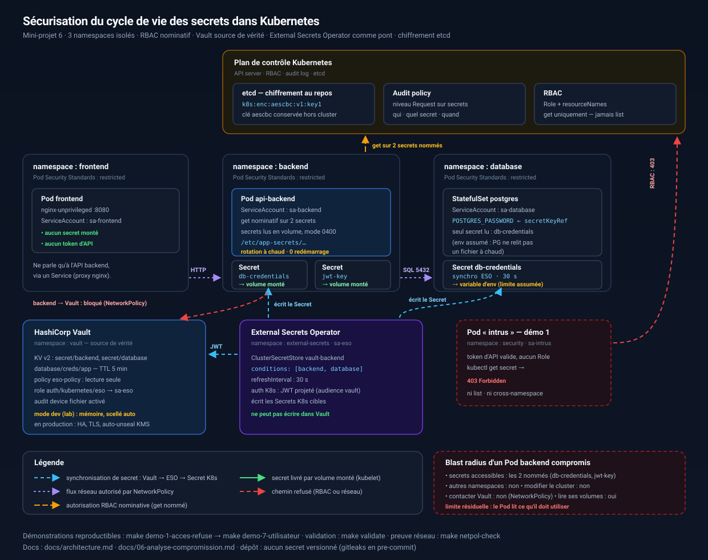

# Architecture cible



> Le schéma est aussi disponible en `docs/architecture.svg` (vectoriel, à
> projeter en soutenance) — il est volontairement lisible sans explication
> orale.

## 1. Composants et flux

| Composant | Namespace | ServiceAccount | Accès aux secrets | Injecté comment |
|-----------|-----------|----------------|-------------------|-----------------|
| Pod frontend | `frontend` | `sa-frontend` | **aucun** | — |
| Pod api-backend | `backend` | `sa-backend` | `db-credentials`, `jwt-key` (`get`) | **volume monté**, `0400` |
| Pod PostgreSQL | `database` | `sa-database` | `db-credentials` (`get`) | `secretKeyRef` (env) |
| External Secrets Operator | `external-secrets` | `sa-eso` | lecture Vault, écriture des Secrets K8s | — |
| HashiCorp Vault | `vault` | `vault` / `vault-auth` | source de vérité de tous les secrets | — |

## 2. Pourquoi trois namespaces et pas un seul

| Namespace | Contenu | Ce que l'isolation apporte |
|-----------|---------|----------------------------|
| `frontend` | nginx | Un `Role` n'est valable que dans son namespace : un `RoleBinding` maladroit dans `backend` ne peut pas donner de droit au frontend |
| `backend` | API | Les secrets les plus sensibles (S1, S2, S3) sont confinés ici |
| `database` | PostgreSQL | Un dump de la base ne donne pas accès aux secrets de l'API |

Un namespace unique aurait suffi techniquement ; il aurait aussi permis à un
`RoleBinding` unique de tout exposer d'un coup. Ici, une erreur de configuration
reste **locale à un namespace** : c'est le principe du blast radius appliqué à
la configuration.

## 3. Flux de synchronisation

```
1. Vault détient les secrets (KV v2) et peut créer des credentials PostgreSQL
   dynamiques (TTL 5 min, rôle jetable).
2. ESO s'authentifie auprès de Vault avec le JWT projeté du ServiceAccount
   sa-eso (auth Kubernetes + TokenReview). Le rôle Vault `eso` n'accepte que
   ce nom + ce namespace + l'audience `vault`.
3. ESO interroge Vault toutes les 30 s (refreshInterval) et pousse les valeurs
   dans les Secrets Kubernetes de `backend` et `database`.
4. Les Pods consomment ces Secrets via des volumes montés (jamais en variables
   d'environnement dans les manifests, sauf PostgreSQL — limite assumée).
```

## 4. Flux réseau (NetworkPolicy)

| Source | Destination | Port | Autorisé | Raison |
|--------|-------------|------|----------|--------|
| `frontend` | `backend` | 8080 | oui | Appel applicatif |
| `backend` | `database` | 5432 | oui | SQL |
| `backend` | `vault` | 8200 | **non** | Le backend ne doit jamais parler à Vault |
| `backend` | API server | 443/6443 | oui (lab) | Démo 2 ; à retirer en production |
| `external-secrets` | `vault` | 8200 | oui | Synchronisation |
| `vault` | `database` | 5432 | oui | Dynamic secrets |
| `vault` | API server | 443/6443 | oui | TokenReview |
| tout autre | tout | — | **non** | `default-deny-all` par namespace |

## 5. Chaîne de confiance (résumé en une ligne)

> Un secret est créé aléatoirement, stocké dans Vault, synchronisé par ESO dans
> un Secret Kubernetes **chiffré dans etcd**, livré par le kubelet dans un
> **volume en lecture seule** au seul processus autorisé, lu à chaque requête
> pour être **rotationnable sans redémarrage**, et chaque accès est **tracé**
> dans l'audit et refusé par défaut à tout autre chemin (RBAC pour l'API,
> NetworkPolicy pour le réseau).

## 6. Ce que le schéma ne montre pas (et qui compte)

- **L'audit** : chaque lecture de Secret apparaît dans l'audit log de l'API
  server, chaque lecture Vault dans le device d'audit de Vault.
- **La rotation de la clé etcd** : procédure documentée (partie 4), non
  automatisée.
- **La détection runtime** : Falco n'est pas déployé ; c'est le complément
  naturel pour couvrir le cas « workload légitime compromis ».
- **La production** : Vault HA (Raft 3 nœuds), TLS, auto-unseal KMS, OIDC pour
  les humains, PVC pour PostgreSQL. Le lab privilégie la démonstration.
